# Laporan Praktikum 4: CSS Layout

 **Nama**:  Naifah Alya Kamilah 

 **NIM**: 312510193 

 **Program Studi**: Teknik Informatika 

 **Mata Kuliah**: Pemrograman Web 

## Tujuan Praktikum

1. Memahami struktur dasar pembuatan layout.
2. Memahami konsep box element.
3. Memahami CSS floating.
4. Memahami HTML 5 semantic element.
5. Membuat layout web sederhana.

## Struktur Folder

```
Lab4Web/
├── images/              (screenshot laporan + profil.jpg)
├── lab4_box.html        (latihan box element, float, clear)
├── lab4_layout/
│   ├── home.html
│   ├── about.html
│   ├── kontak.html
│   └── style.css
└── README.md
```


# Bagian 1: Box Element, Float, dan Clear

File: `lab4_box.html`

Semua elemen HTML pada dasarnya adalah **box** yang terdiri dari margin, border, padding, dan content. Tag `div` sering dipakai untuk membuat layout karena sifatnya sebagai box.

### 1.1 Persiapan dokumen

Membuat file `lab4_box.html` berisi kerangka HTML5 dan sebuah `<header>` dengan judul "Box Element".

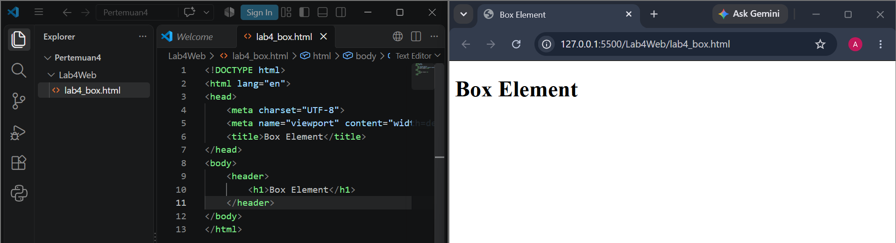

### 1.2 Membuat box element dengan div

Menambahkan tiga `div` (`div1`, `div2`, `div3`) di dalam `<section>`. Karena `div` adalah elemen block, ketiganya tampil **menumpuk ke bawah** dan memenuhi lebar halaman.

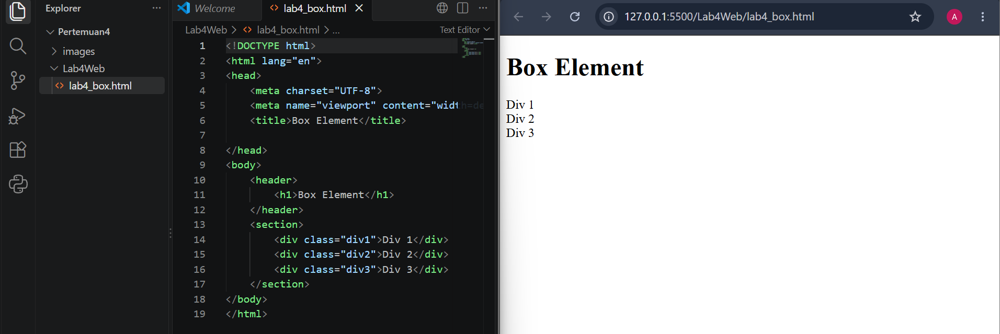

### 1.3 CSS float

Menambahkan CSS `float: left` dan `padding: 10px` pada semua `div`, lalu warna latar merah, kuning, hijau.

```css
div {
    float: left;
    padding: 10px;
}
```

Hasilnya ketiga div **berjejer ke samping** dan lebarnya menyesuaikan isi, karena elemen yang di-float keluar dari alur normal.

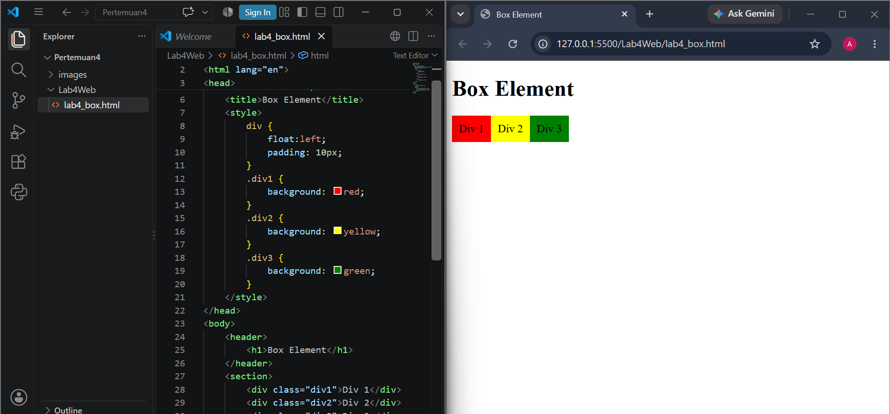

### 1.4 Clearfix dengan property clear

Menambahkan `div4` setelah `div3`. Agar `div4` tidak ikut berjejer di samping div yang di-float, dipakai `clear: left` dan `float: none`.

```css
.div4 {
    background-color: blue;
    clear: left;
    float: none;
}
```

Hasilnya `div4` turun ke baris baru dan membentang selebar halaman.

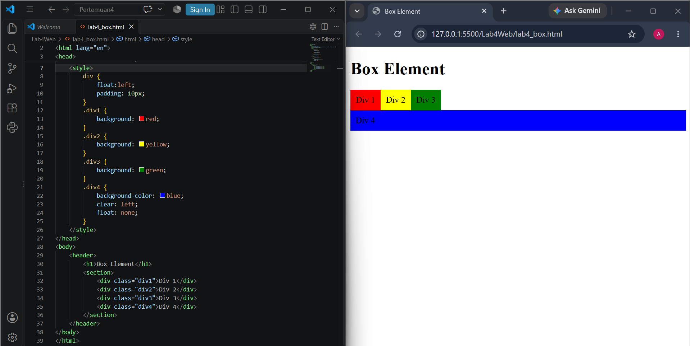

### 1.5 Eksperimen nilai clear

Nilai `clear` pada `.div4` diubah-ubah untuk melihat perbedaannya.

**`clear: right`**: div4 tidak turun, karena tidak ada elemen yang di-float ke kanan. Div4 tetap berada sejajar dengan div1-div3.

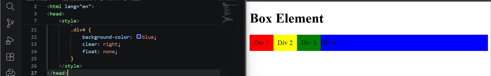

**`clear: both`**: div4 turun ke bawah. Nilai `both` membersihkan float kiri dan kanan sekaligus, jadi paling aman dipakai.

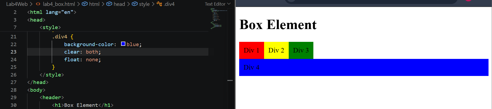

**`clear: none`**: sama seperti `right`, tidak ada yang dibersihkan sehingga div4 tidak turun.

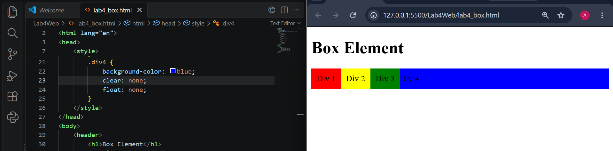

**Menghapus `float: none` dari div4** (hanya `clear: left`): div4 tetap turun ke bawah, tetapi karena masih terkena aturan `div { float: left }`, lebarnya hanya sebesar isinya dan tidak memanjang.

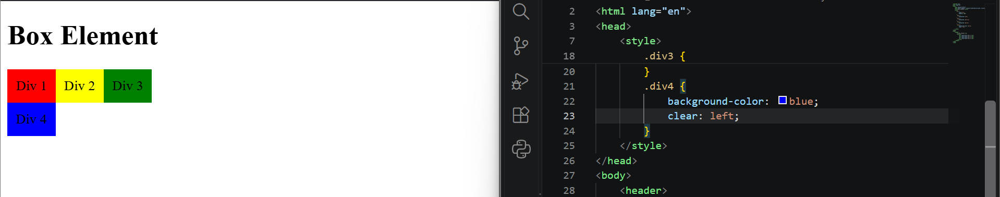

## 1.6 Validasi HTML

Hasil validasi `lab4_box.html` di validator.w3.org: **0 error, 1 warning**. Warning muncul karena `<section>` tidak memiliki heading (h2-h6). Ini bukan error dan tidak mempengaruhi tampilan.

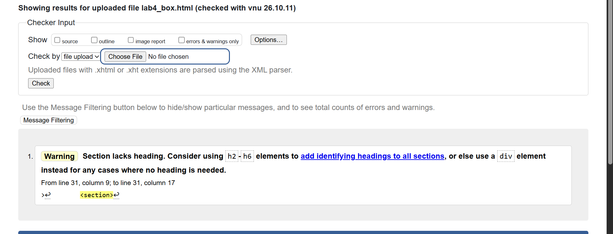

---

# Bagian 2: Membuat Layout Web Sederhana

Folder: `lab4_layout` (file `home.html` dan `style.css`)

Layout dibuat dengan **semantic element** HTML5: `header`, `nav`, `section`, `aside`, dan `footer`, dibungkus oleh `div#container`.

### 2.1 Kerangka layout (HTML)

Menulis struktur halaman: header, nav (menu Home, Artikel, About, Kontak), section hero, section wrapper (berisi main dan sidebar), dan footer. Belum ada CSS sehingga tampilan masih polos.

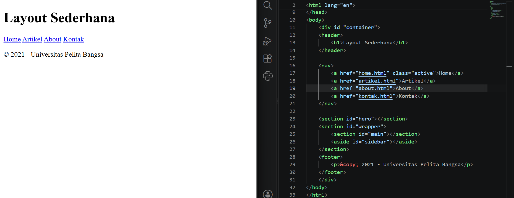

### 2.2 CSS awal: font, reset, container, header

- `@import` untuk font **Open Sans** dari Google Fonts.
- **Reset CSS** `* { margin: 0; padding: 0; }` untuk menghapus jarak bawaan browser.
- `#container` dengan lebar 980px dan `margin: 0 auto` agar berada di tengah halaman, ditambah `box-shadow`.
- Styling `header` dan `header h1`.

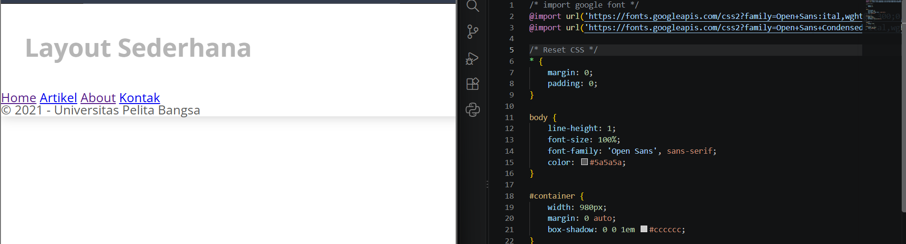

### 2.3 Navigasi

Menu diberi latar biru. Link dibuat `display: inline-block` supaya tetap berjejer ke samping tetapi bisa diberi padding atas-bawah. Menu `.active` dan saat `:hover` berwarna lebih terang.

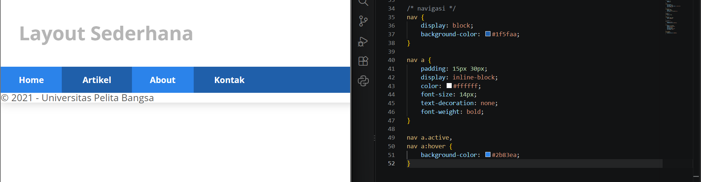

**Eksperimen:** mengubah nilai `display` pada `nav a` untuk melihat pengaruhnya pada tinggi menu.

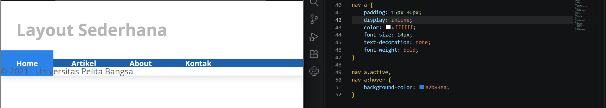

**Eksperimen:** memindahkan `class="active"` dari Home ke Artikel, sehingga menu yang menyala ikut berpindah.

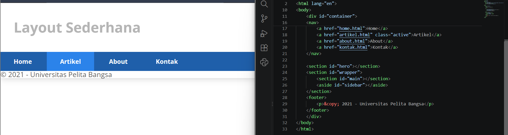

### 2.4 Hero panel

Menambahkan HTML hero ("Hello World!", paragraf, link "Learn more") lalu CSS-nya: latar abu-abu, padding 50px 20px, dan ukuran teks heading dan paragraf. Selector `#hero h1` dipakai agar tidak mengubah `h1` di header.

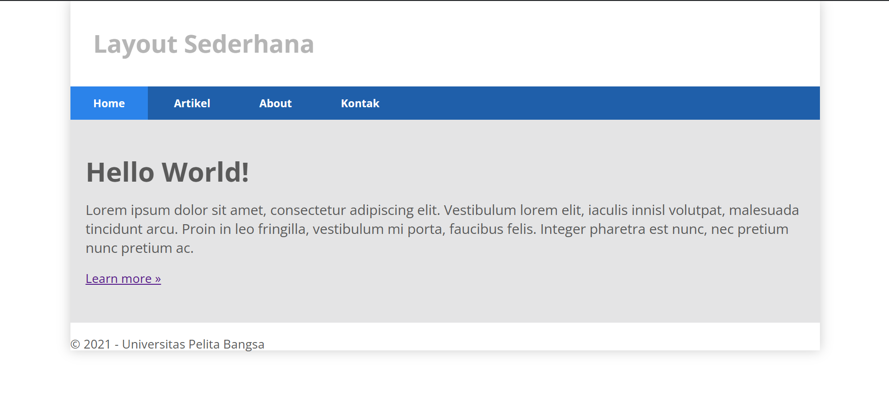

### 2.5 Layout main dan sidebar, serta footer

`#main` (lebar 640px) dan `#sidebar` (lebar 260px) sama-sama di-`float: left` sehingga berdampingan.

Perhitungan lebar: (640 + 20 + 20) + (260 + 20 + 20) = 680 + 300 = **980px**, pas selebar container.

Karena `#main` dan `#sidebar` di-float, pembungkus `#wrapper` tingginya jadi 0 dan footer naik. Solusinya `clear: both` pada footer.

Footer sebelum diberi `clear: both`:

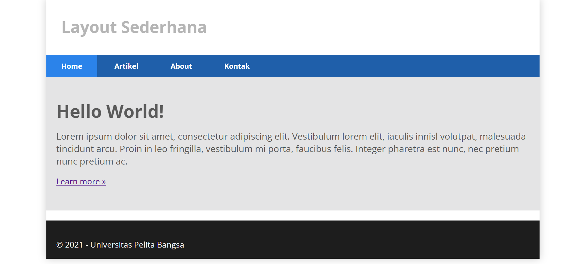

Footer setelah diberi `clear: both`:

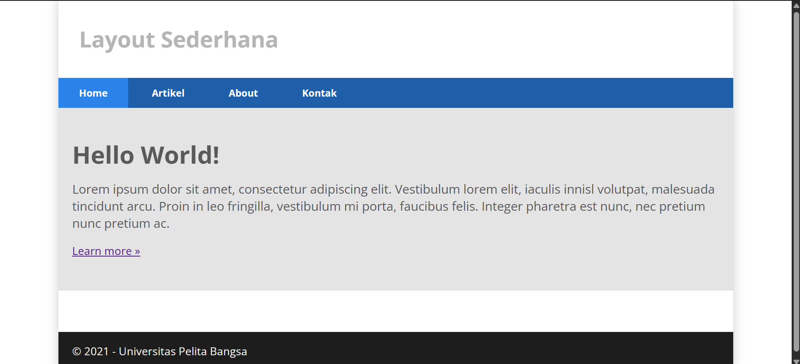

### 2.6 Sidebar widget

Mengisi sidebar dengan dua widget: **Widget Header** (daftar link) dan **Widget Text** (paragraf). Judul widget berlatar biru, daftar tanpa bullet, dan baris berubah warna saat di-hover. Link dibuat `display: block` agar seluruh baris bisa diklik.

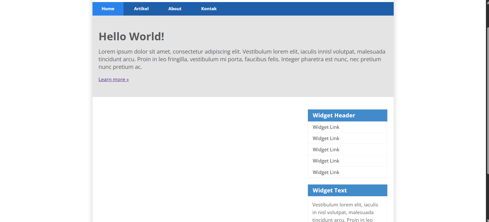

### 2.7 Tiga box di main content

Tiga `div.box` berisi gambar bulat, heading, teks, dan tombol, masing-masing selebar 33.33% dan di-float ke kiri. Beberapa hal yang dipakai:

- `box-sizing: border-box` agar padding dihitung masuk ke lebar, sehingga tiga box muat dalam satu baris.
- `border-radius: 50%` membuat gambar menjadi lingkaran.
- **Clearfix** pada `.row` (`.row:after { clear: both }`) supaya `.row` ikut menampung tinggi box yang di-float.

**Eksperimen:** menghapus `box-sizing: border-box`. Lebar box jadi lebih dari 33.33% karena padding ditambahkan di luar width, sehingga box ketiga jatuh ke baris bawah.

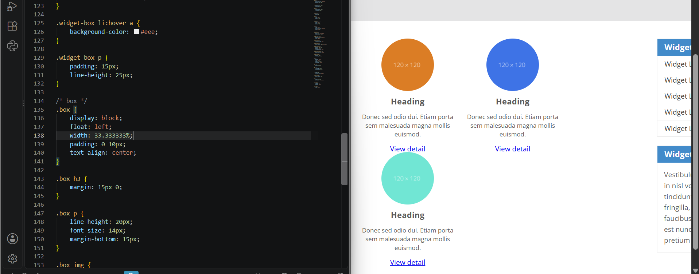

Hasil dengan `box-sizing: border-box`:

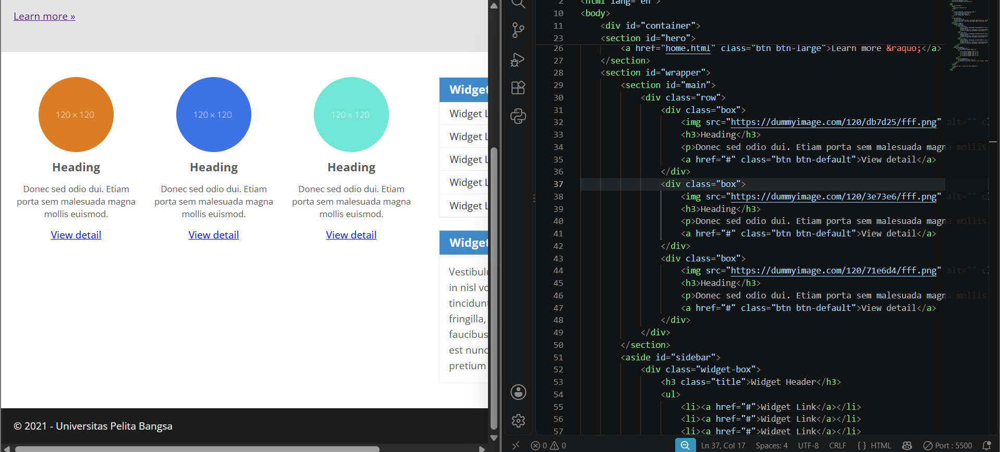

### 2.8 Artikel

Menambahkan dua `<article class="entry">` yang dipisah garis `<hr class="divider">`. Gambar artikel pertama di-float ke kiri, gambar artikel kedua memakai class `right-img` agar di-float ke kanan. Teks mengalir di samping gambar.

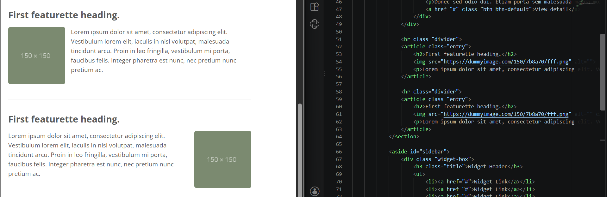

### 2.9 Tombol

Class `btn`, `btn-large`, dan `btn-default` dipakai di HTML tetapi CSS-nya tidak ada di modul, sehingga saya menambahkannya sendiri. Hasilnya "Learn more" menjadi tombol biru dan "View detail" menjadi tombol abu-abu.

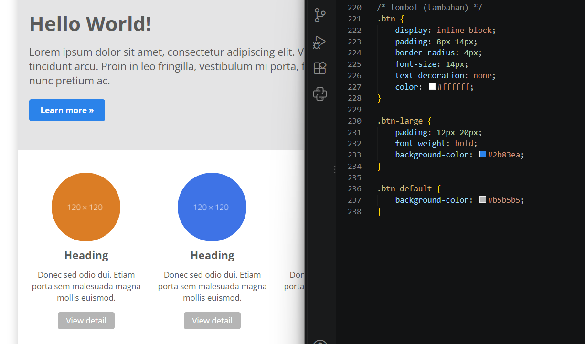

## 2.10 Validasi `home.html`

Validasi pertama menemukan **1 error**: urutan heading melompat dari `h1` langsung ke `h3` (heading "Heading" di tiga box). Diperbaiki dengan mengganti `h3` menjadi `h2` dan menyesuaikan ukuran font lewat CSS `.box h2`.

Setelah diperbaiki: **0 error dan 2 warning**:

1. `<section id="wrapper">` tidak memiliki heading.
2. Ada lebih dari satu `h1` (di header dan di hero).

Keduanya hanya warning dan strukturnya mengikuti modul.

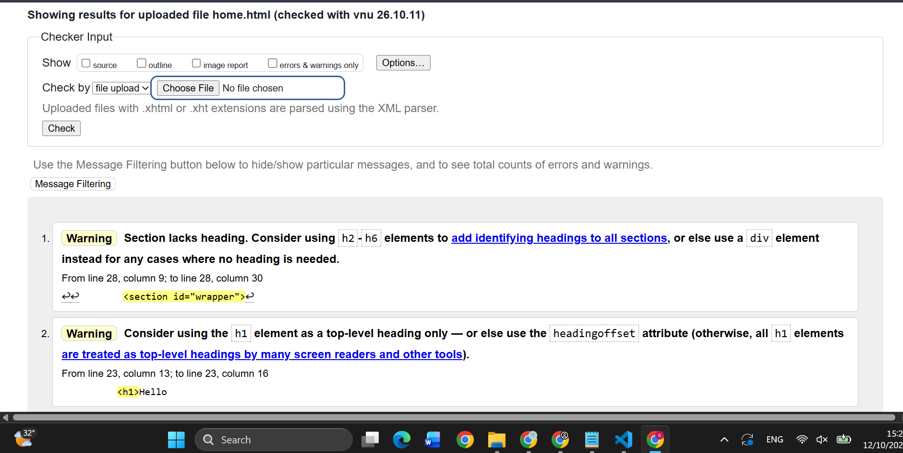

---

# Tugas

## Tugas 1: Halaman About

File: `lab4_layout/about.html`

Halaman single layout (tanpa sidebar) yang berisi:

- **Profil**: foto di kiri (`float: left`) dengan biodata di sampingnya.
- **Skill**: daftar skill dalam bentuk list.
- **Portfolio**: tiga kotak project yang berjejer (`float: left`, border, padding).

Judul "Skill" dan "Portfolio" diberi `clear: both` supaya turun di bawah elemen yang di-float. Menu **About** diberi `class="active"`.

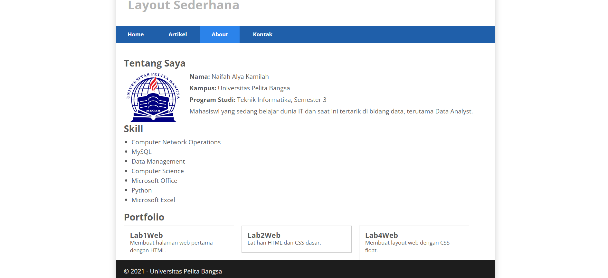

Hasil validasi: **tidak ada error maupun warning**.

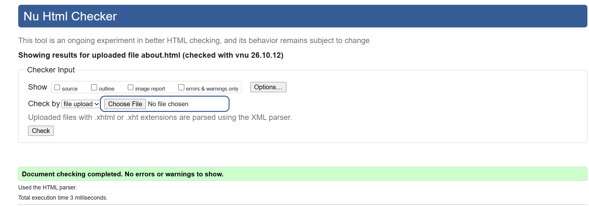

## Tugas 2: Halaman Contact (Kontak)

File: `lab4_layout/kontak.html`

Halaman berisi form dengan isian **Nama**, **Email**, **Subjek**, dan **Message**, serta tombol Kirim.

- `label` dihubungkan ke `input` memakai `for` dan `id`, sehingga klik pada label langsung memilih isiannya.
- `input type="email"` otomatis dicek browser. Pada screenshot terlihat peringatan saat alamat email tidak memakai tanda `@`.
- `label`, `input`, dan `textarea` dibuat `display: block` agar tersusun ke bawah, dengan `padding`, `border`, dan `margin-bottom` (konsep box element).

Form ini belum mengirim data ke mana pun (`action="#"`), karena pengiriman data memerlukan program di sisi server yang belum dipelajari di praktikum ini.

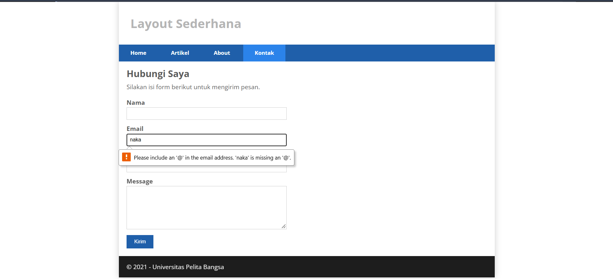

Hasil validasi: **tidak ada error maupun warning**.

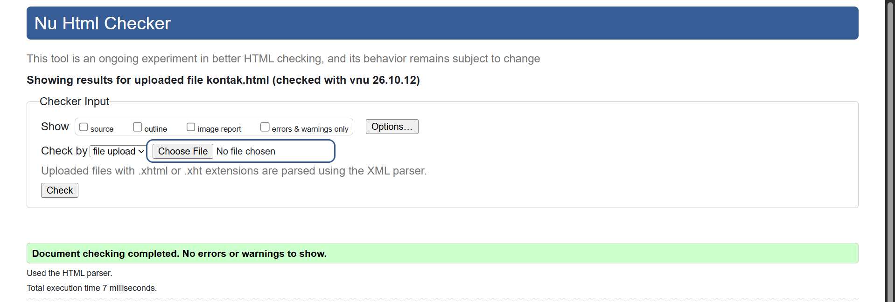

---

# Kendala dan Solusi

| Kendala | Penyebab | Solusi |
|---|---|---|
| Kode CSS dari modul merah dan error saat di-copy | Hasil copy dari PDF membawa karakter aneh dan baris terpotong | Mengetik ulang kode CSS dan menghapus `@import` font kedua yang tidak dipakai |
| Footer naik ke atas setelah main dan sidebar di-float | Elemen float keluar dari alur normal sehingga `#wrapper` tingginya 0 | Menambahkan `clear: both` pada footer |
| Validasi `home.html` error (h1 ke h3) | Level heading melompat | Mengganti `h3` menjadi `h2` |
| Gambar kedua artikel tidak pindah ke kanan | Di modul tertulis class `rightimg`, sedangkan CSS memakai `.right-img` | Menyamakan nama class menjadi `right-img` |
| Foto profil tidak tampil di About | Folder `images` berada di luar folder `lab4_layout`, jalur `src` salah | Memindahkan `images` ke dalam `Lab4Web` dan memakai `src="../images/profil.jpg"` |
| Tombol tidak berbentuk tombol | CSS `.btn` tidak ada di modul | Menambahkan CSS `.btn`, `.btn-large`, `.btn-default` |

# Kesimpulan

Dari praktikum ini saya belajar bahwa:

1. Semua elemen HTML adalah box yang terdiri dari margin, border, padding, dan content.
2. `float` membuat elemen mengambang sehingga bisa disusun berdampingan, tetapi elemen yang di-float keluar dari alur normal dan membuat pembungkusnya menjadi tinggi 0.
3. `clear` dan teknik **clearfix** diperlukan agar elemen setelah float tidak ikut naik dan pembungkus bisa menampung tinggi isinya.
4. `box-sizing: border-box` memudahkan perhitungan lebar karena padding dan border ikut dihitung dalam width.
5. Semantic element (`header`, `nav`, `section`, `aside`, `footer`) membuat struktur halaman lebih jelas dibanding `div` biasa.
6. Validasi HTML membantu menemukan kesalahan, misalnya urutan heading yang salah.
